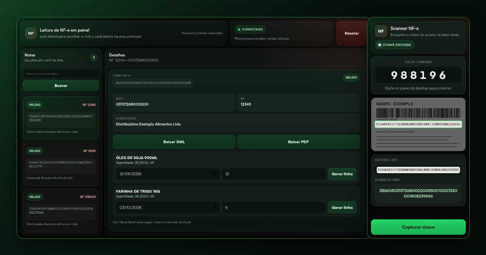
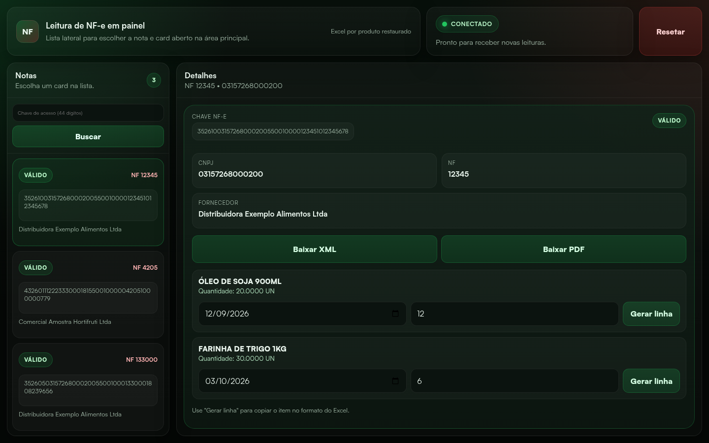
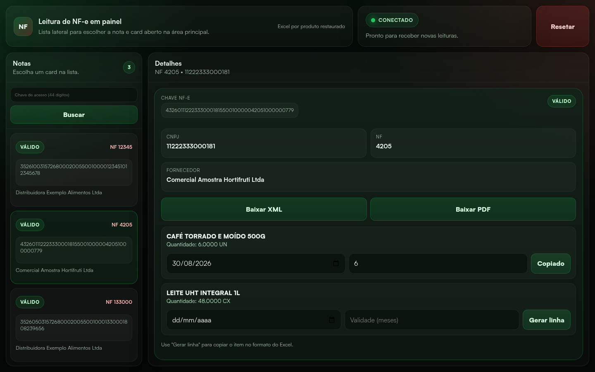
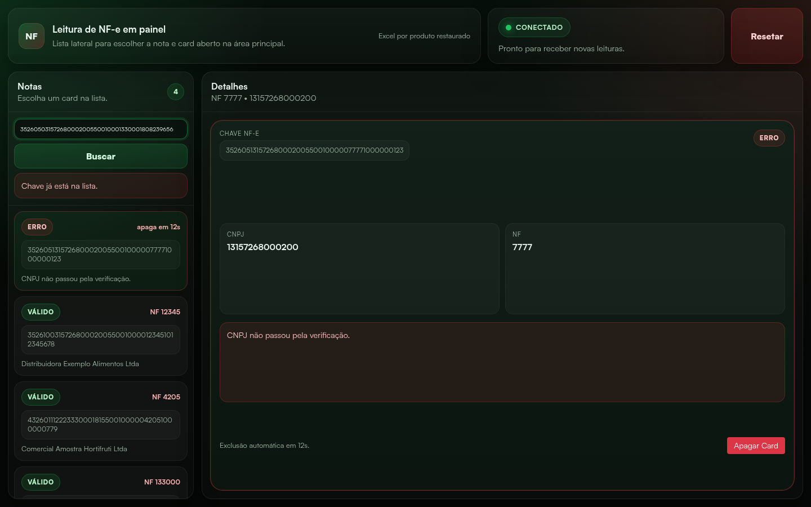
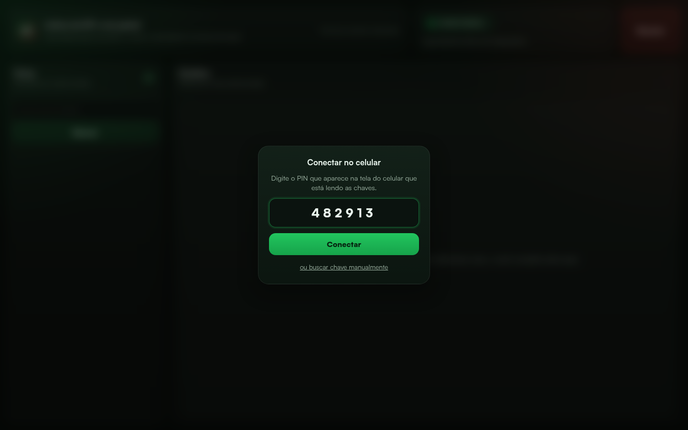
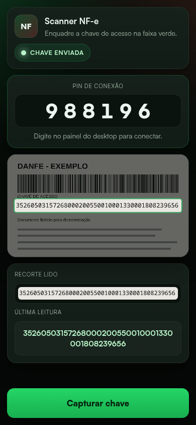

# Scanner NF-e

Scanner de nota fiscal (NF-e) que usa a **câmera do celular** para ler a chave de
acesso via OCR e exibe os dados da nota em um **painel web** (fornecedor, produtos,
fabricação e validade), com exportação da linha no formato de planilha.

Feito para o fluxo de recebimento de mercadoria: aponta o celular para a chave da
NF-e, a chave é lida e a nota aparece no painel para conferência.



## Apresentação

No recebimento de mercadoria, conferir uma nota significa digitar 44 dígitos, abrir
a consulta do DANFE, anotar fornecedor e produtos e registrar fabricação e validade
de cada item. O Scanner NF-e encurta esse caminho: **aponte o celular, receba a nota
no computador e cole a linha na planilha**.

1. **Conecte** — o celular mostra um PIN de 6 dígitos; digite-o no painel.
2. **Capture** — enquadre a chave de acesso na faixa verde; o OCR roda no aparelho.
3. **Confira** — CNPJ, número da nota, fornecedor e produtos aparecem no painel.
4. **Exporte** — informe fabricação e validade e clique em **Gerar linha**.

### Destaques

- Sem app para instalar: duas páginas web ligadas por **P2P (PeerJS)**.
- **Busca manual** pela chave digitada, quando não houver celular à mão.
- Segunda API como **fallback** quando a consulta principal falha ou demora.
- Linha separada por tabulação, pronta para o Excel.
- Download do **XML** e do **PDF (DANFE)** de cada nota.
- Suíte automática que testa as páginas reais, com teste de mutação.

### Telas

| Painel com as notas lidas | Linha copiada para a planilha |
|---|---|
|  |  |
| **Busca manual e tratamento de erro** | **Conexão por PIN** |
|  |  |



> Fornecedores, produtos e o documento das imagens são fictícios; a chave de acesso
> e o CNPJ são de exemplo.

## Como funciona

O sistema tem duas páginas que se comunicam **P2P via PeerJS**:

```
┌─────────────────┐   PeerJS (P2P)   ┌──────────────────────┐
│   phone.html    │ ────────────────▶ │     viewer.html      │
│ (no celular)    │  chave + imagem   │ (painel no desktop)  │
│  OCR da chave   │                   │ consulta APIs da NF-e│
└─────────────────┘                   └──────────────────────┘
```

1. **`phone.html`** — abre no celular, acessa a câmera, recorta a área da chave e
   usa **Tesseract.js** para extrair os 44 dígitos da chave de acesso.
2. **`viewer.html` + `viewer.js`** — abre no desktop, recebe a chave via PeerJS,
   valida o CNPJ embutido na chave e consulta:
   - **Produtos** da nota (via proxy Nginx → API de consulta de DANFE);
   - **Nome do fornecedor** (via proxy Nginx → ReceitaWS).
3. Para cada produto, o painel permite preencher **fabricação** e **validade (meses)**
   e gerar uma linha copiável no formato de planilha (separada por tab).

## Estrutura do projeto (modular)

O código-fonte vive em `src/`, organizado em módulos de arquivo único por
responsabilidade. `tools/build.js` (sem dependências) gera os artefatos que o
navegador e os testes consomem — `viewer.js` e `phone.html` são **gerados, não
editar a mão** (o `api.py` fica em arquivo único Python, sem build).

```
src/viewer/          painel, um arquivo por responsabilidade:
  config.js            URLs das APIs e timings
  dom.js               referências aos elementos da página
  state.js             dados mutáveis do app
  utils.js             CNPJ, XML, datas, status, linha da planilha
  api.js               consulta do XML (primária + fallback) e do CNPJ
  domain.js            ciclo de vida do scan e da planilha
  render.js            montagem dos cards e da tela
  events.js            listeners (clique, input, reset, relógio)
  boot.js              conexão PeerJS com o celular
src/phone/
  script.js            lógica do celular (câmera, recorte, OCR, envio)
  index.html           marcação da página (template com {{SCRIPT}})
tools/build.js       gera viewer.js e phone.html a partir de src/
```

```bash
npm run build    # regenera viewer.js e phone.html (valida o contrato da suíte)
npm test         # build + suíte JS
```

Os artefatos são mantidos versionados porque a hospedagem é estática (ver
`deploy/`). O build falha se os trechos de código que o `tests/sanity.py` muta não
aparecerem exatamente uma vez.

## Arquivos

| Arquivo | Papel |
|---|---|
| `src/` | Código-fonte modular (o que você edita) |
| `phone.html` | **Gerado**: app do celular (câmera + OCR + envio via PeerJS) |
| `viewer.html` | Painel do desktop (marcação + estilos) |
| `viewer.js` | **Gerado**: lógica do painel (recebe chaves, consulta APIs, renderiza) |
| `api.py` | Script auxiliar: consulta o meudanfe.com.br via chromedriver |
| `tools/build.js` | Build zero-deps: concatena `src/` nos artefatos |
| `deploy/` | Config do Nginx e instruções de implantação |

## Rodando localmente

Como as páginas usam `getUserMedia` (câmera) e conexões P2P, é preciso servir por
HTTP**S** (ou `localhost`, que é tratado como contexto seguro):

```bash
# qualquer servidor estático, por exemplo:
python3 -m http.server 8080
# ou
npx serve .
```

Abra `viewer.html` no desktop e `phone.html` no celular (mesmo domínio/porta). Num
aparelho diferente da máquina que serve as páginas, a câmera só funciona por HTTPS.
O celular gera um **PIN de 6 dígitos** (que é o PeerID da sessão) e o exibe na
tela; no desktop, digite esse PIN no modal e clique **Conectar**. O celular atende
um painel por vez e recusa os demais. O PIN evita conexões cruzadas, mas **não é
autenticação forte**: são 6 dígitos num servidor público de sinalização.

## Testes

A suíte cobre a lógica de ponta a ponta **sem reescrever nada**: os testes
carregam `viewer.html`, `viewer.js` e o script do `phone.html` reais dentro de um
jsdom, controlando só as fronteiras externas (PeerJS, `fetch` das APIs,
clipboard e relógio). Serve de rede de segurança para a refatoração.

Requer **Node.js 22.22.2+, 24.15+ ou 26+** (exigência do jsdom) e Python 3.10+.

```bash
npm install                 # só jsdom (dev)
npm test                    # node:test  → viewer + celular
npm run test:py             # unittest   → api.py
python3 tests/sanity.py     # quebra o código de propósito e exige que os testes falhem
```

| Arquivo | O que valida |
|---|---|
| `tests/viewer.core.test.js` | CNPJ, limpeza de XML, datas, layout da chave de 44 dígitos |
| `tests/viewer.api.test.js` | produtos do XML, fallback, timeout de 15s, fornecedor |
| `tests/viewer.scan.test.js` | processamento, deduplicação, erros, limpeza/reset |
| `tests/viewer.queue.test.js` | fila de 1s entre consultas e auto-exclusão de 15s |
| `tests/viewer.ui.test.js` | cards por estado, seleção, inputs e a linha da planilha |
| `tests/viewer.manual.test.js` | busca manual da chave (formato, duplicata, sem celular) |
| `tests/viewer.download.test.js` | download do XML e do PDF: bytes originais, nota certa, PDF ausente |
| `tests/viewer.pin.test.js` | modal do PIN no painel e erros de conexão |
| `tests/viewer.security.test.js` | dados externos exibidos como texto, chave validada, queda da conexão |
| `tests/phone.conn.test.js` | um painel por vez no celular e reconexão |
| `tests/phone.mira.test.js` | área verde igual ao recorte lido pelo OCR |
| `tests/viewer.queda.test.js` | prazo de conexão, queda do celular e reconexão no painel |
| `tests/phone.queda.test.js` | painel que some sem avisar, envio perdido e reconexão |
| `tests/phone.ocr.test.js` | câmera, recorte da área verde, extração da chave, envio |
| `tests/phone.pin.test.js` | geração do PIN e colisão no celular |
| `tests/phone.status.test.js` | cor do status do celular por estado |
| `tests/test_api_cli.py` | validação de CLI e filtro CDP do `api.py` |

Quatro testes ficam **`skip` de propósito**: codificam a intenção de bugs já
conhecidos que a refatoração precisa corrigir.
Não apague — desative o `skip` quando o bug for corrigido.

## APIs consumidas (via proxy Nginx)

O `viewer.js` chama os endpoints abaixo, todos resolvidos pelo Nginx (ver `deploy/`):

| Caminho local | Destino remoto | Uso |
|---|---|---|
| `POST /api/nfe/` | `consultadanfe.com/api/v1/consulta` | XML (produtos) e PDF da nota |
| `GET /api/nfe/fallback/{chave}` | `api.danferapida.com.br/...` | Fallback do XML e do PDF |
| `GET /receita/v1/cnpj/{cnpj}` | `receitaws.com.br` | Nome do fornecedor |

> O painel usa **URLs relativas** (`src/viewer/config.js`): o site precisa ser
> servido com o proxy do Nginx na **mesma origem**. Num servidor estático local a
> página abre, mas as consultas de nota e fornecedor falham. No config de exemplo,
> troque `example.com` e `site-user` pelos seus.

## api.py

Script independente que automatiza o meudanfe.com.br com `undetected_chromedriver`:

```bash
pip install -r requirements.txt   # exige Google Chrome instalado
python api.py <chave_de_acesso_44_digitos>
```

Imprime no stdout a resposta do DANFE para a chave informada. Se o Chrome instalado
não for o mais recente, informe a versão principal: `CHROME_MAJOR=148 python api.py ...`.

## Implantação

O Nginx do CloudPanel serve os arquivos estáticos e faz o proxy das APIs.
O config de referência está em `deploy/nginx.conf.example`.

Publique na raiz do site **apenas** `viewer.html`, `viewer.js` e `phone.html` (não o
repositório inteiro).

As rotas de consulta aceitam só o método e o caminho que o painel usa, não liberam
CORS e têm limite de taxa. Isso **não autentica ninguém**: restrinja o acesso ao
servidor (há um `allow`/`deny` comentado no exemplo) para que terceiros não gastem
a sua cota de consultas.

A API key do fallback (danferapida) **não** fica no config versionado — ver
`deploy/secrets/danferapida.key.conf.example`.

## Stack

- **Front:** HTML, CSS e JavaScript puro, com build sem dependências (`tools/build.js`)
- **OCR:** Tesseract.js
- **P2P:** PeerJS
- **UI:** CSS próprio, com a mesma identidade nas duas telas (`visual.md`)
- **Aux:** Python + undetected-chromedriver
- **Servidor:** Nginx (proxy + estáticos)
