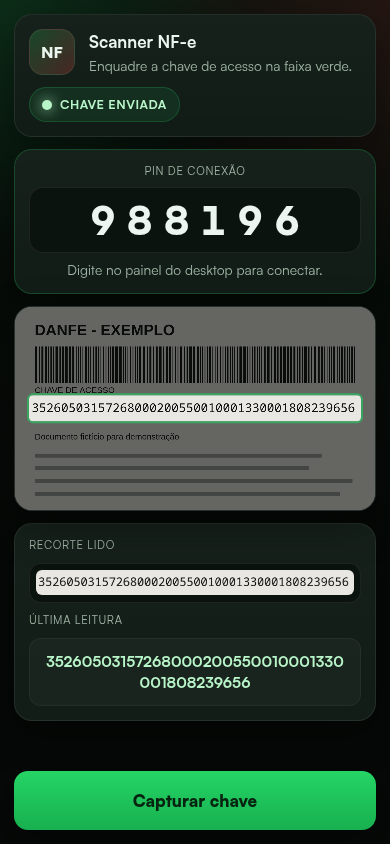

# Arquitetura

## Stack

| Camada | Tecnologia |
|---|---|
| Painel desktop | HTML, CSS e JavaScript puro (`viewer.html`, `viewer.js`) |
| App do celular | HTML, CSS e JavaScript puro (`phone.html`) |
| OCR | Tesseract.js, executado no celular |
| Celular → painel | PeerJS (WebRTC) |
| Consultas externas | Nginx como proxy de mesma origem |
| Auxiliar | Python + undetected-chromedriver (`api.py`) |
| Testes | jsdom + `node:test` + `unittest` |

## Fluxo

```
┌─────────────────┐   PeerJS (P2P)    ┌──────────────────────┐
│   phone.html    │ ────────────────▶ │     viewer.html      │
│ (no celular)    │  chave + imagem   │ (painel no desktop)  │
│  OCR da chave   │                   │ consulta a NF-e      │
└─────────────────┘                   └──────────┬───────────┘
                                                 │ Nginx (proxy, URLs relativas)
                          ┌──────────────────────┼──────────────────────┐
                          ▼                      ▼                      ▼
                 consultadanfe.com      api.danferapida.com.br   receitaws.com.br
                  (XML primário)           (XML fallback)        (nome do CNPJ)
```

1. O celular recorta a faixa central do vídeo, roda o Tesseract só com dígitos e
   envia `{ type: 'nfe', key }` com a imagem do recorte.
2. O painel enfileira a chave, cria o cartão e extrai CNPJ (`chave.slice(6, 20)`)
   e número da nota (`chave.slice(25, 34)`).
3. Com o CNPJ válido, consulta fornecedor e produtos em paralelo.
4. O XML vem em base64 da API primária ou como texto do fallback; o parser lê
   `xProd`, `qCom` e `uCom`.
5. Cada produto ganha uma linha na tabela em memória, que alimenta o **Gerar linha**.

## Código-fonte e build

`src/viewer/` tem um módulo por responsabilidade (`config`, `dom`, `state`,
`utils`, `api`, `domain`, `render`, `events`, `boot`); `src/phone/` separa marcação
e script. `tools/build.js`, sem dependências, concatena tudo em `viewer.js` e
`phone.html` e falha se um nome ou trecho exigido pela suíte sumir.

Os arquivos gerados são versionados: publicar é copiar arquivos estáticos.

## Decisões

- **Sem backend próprio.** As chaves lidas trafegam por PeerJS; as consultas passam
  pelo Nginx para evitar CORS e manter a chave de API fora do navegador. O preço é
  depender do broker público do PeerJS.
- **PIN como PeerID.** Substituiu um identificador fixo, ao qual qualquer painel
  podia se conectar. Se o PIN já estiver em uso, o celular gera outro.
- **Um só caminho para a chave.** A busca manual entra na mesma fila das leituras do
  celular, com a mesma deduplicação e os mesmos cartões.
- **Ritmo controlado.** Uma nota por vez, com 1 s entre consultas para evitar 429,
  e teto de 15 s na API primária antes do fallback.
- **Testar o que o navegador executa.** A suíte carrega os arquivos gerados dentro
  do jsdom e controla apenas as fronteiras externas.
- **Mesma identidade nas duas telas.** Cores, tipografia e componentes são
  descritos em `visual.md` e compartilhados por celular e painel.

## Limitações conhecidas

- O PIN de 6 dígitos evita conexões cruzadas, mas não é autenticação forte.
- A chave é conferida só pelo CNPJ embutido, sem o dígito verificador.
- Quatro bugs estão marcados com `test.skip`: índice órfão ao apagar nota, campos
  que perdem o valor no redesenho da tela, acentos quebrados no `atob` da API
  primária e OCR aceitando a janela errada de dígitos.


