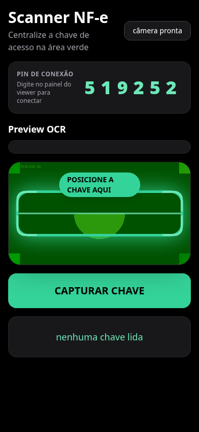

# Arquitetura

## Stack

| Camada | Tecnologia |
|---|---|
| Painel desktop | HTML + CSS + JavaScript puro (`viewer.html`, `viewer.js`) |
| App do celular | HTML + Tailwind CDN + JavaScript (`phone.html`) |
| OCR | Tesseract.js (roda no próprio celular) |
| Transporte celular → painel | PeerJS (WebRTC/P2P), sem servidor próprio |
| Consulta da nota | Nginx como proxy de mesma origem para APIs de DANFE e ReceitaWS |
| Auxiliar | Python + undetected-chromedriver (`api.py`) |
| Testes | jsdom + `node:test` + `unittest` |

## Fluxo

```
┌─────────────────┐   PeerJS (P2P)   ┌──────────────────────┐
│   phone.html    │ ────────────────▶ │     viewer.html      │
│ (no celular)    │  chave + imagem   │ (painel no desktop)  │
│  OCR da chave   │                   │ consulta APIs da NF-e│
└─────────────────┘                   └──────────┬───────────┘
                                                 │ Nginx (proxy)
                          ┌──────────────────────┼──────────────────────┐
                          ▼                      ▼                      ▼
                 consultadanfe.com      api.danferapida.com.br   receitaws.com.br
                  (XML primário)           (XML fallback)        (nome do CNPJ)
```

1. O celular recorta a faixa da chave, roda o Tesseract e envia `{type:'nfe', key}`
   para o painel pelo canal PeerJS aberto com o PIN.
2. O painel cria o cartão (estado "lendo"), valida o CNPJ embutido na chave
   (`chave.slice(6,20)`) e dispara em paralelo fornecedor e produtos.
3. Produtos vêm do XML do DANFE: API primária em base64, com fallback automático
   na segunda rota; o parser lê `xProd`, `qCom` e `uCom` de cada `det`.
4. Cada produto ganha uma linha na tabela global; fabricação e validade são
   gravadas nessa linha e a "Gerar linha" copia o registro tab-separado.

## Código-fonte e build

`src/viewer/` é um módulo por responsabilidade (`config`, `dom`, `state`,
`utils`, `api`, `domain`, `render`, `events`, `boot`) e `src/phone/` separa
marcação e script. `tools/build.js` — sem dependências — concatena os módulos
nos artefatos `viewer.js` e `phone.html` e **falha alto** se um literal que a
suíte consome estiver fora do contrato.

Os artefatos ficam **versionados** porque a hospedagem é estática: subir o site é
copiar arquivos, sem etapa de build no servidor.

## Decisões

- **Sem backend próprio.** O tráfego do scanner é P2P (PeerJS); as consultas
  externas passam pelo Nginx para evitar CORS e esconder chaves de API. O preço é
  depender do broker público do PeerJS.
- **PIN como PeerID.** O PeerID do celular é o PIN de 6 dígitos exibido na tela:
  quem não sabe o PIN não conecta. Colisão de ID regenera o PIN. O modal do
  desktop fica bloqueado (blur) até o PIN — a única saída é a busca manual, que
  não toca no peer.
- **Testam-se os artefatos, não o fonte.** A suíte carrega `viewer.html`,
  `viewer.js` e o script real do `phone.html` dentro de um jsdom, controlando só
  as fronteiras externas (PeerJS, `fetch`, clipboard, relógio). Assim o teste
  cobre exatamente o que o navegador vai rodar.
- **Um pipeline só para chave.** A busca manual digitada enfileira no mesmo
  `pendingScans` da leitura do celular — fila serial de 1 s, deduplicação e
  cartões idênticos, sem caminho paralelo que precise de manutenção dupla.
- **Timeout curto e ritmo anti-429.** API primária com teto de 15 s antes do
  fallback, e 1 s entre consultas consecutivas.
- **Cartão de erro morre sozinho** (15 s), mas fica acessível para conferência
  enquanto existe.

## Limitações conhecidas

- A chave é validada só pelo CNPJ embutido; o dígito verificador geral não é
  conferido.
- Quatro bugs conhecidos estão marcados com `test.skip` na suíte (índice órfão ao
  apagar nota, inputs que perdem valor no re-render, UTF-8 quebrado no `atob` da
  API primária e OCR aceitando janela errada de dígitos).
- O `viewer.html` em produção responde, mas a consulta do XML está falhando
  (`POST /api/nfe/` → 400 e fallback → 401): provável chave de API do proxy.


