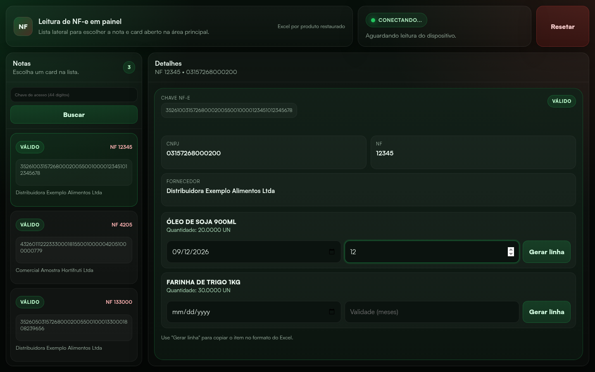

# Scanner NF-e



## Visão geral

Scanner de nota fiscal (NF-e) para o fluxo de **recebimento de mercadoria**: aponta
o celular para a chave de acesso, o OCR lê os 44 dígitos e a nota aparece no
painel do desktop para conferência — fornecedor, produtos, fabricação e validade —
com a linha pronta para colar na planilha.

O sistema tem duas páginas que se comunicam **P2P via PeerJS**, sem backend
próprio para o tráfego do scanner:

1. **`phone.html`** — abre no celular, acessa a câmera, recorta a área da chave e
   usa **Tesseract.js** para extrair os 44 dígitos.
2. **`viewer.html`** — abre no desktop, recebe a chave via PeerJS, valida o CNPJ
   embutido nela e consulta fornecedor e produtos por proxy do Nginx.

## O problema que resolve

No recebimento, conferir uma NF-e na mão é lento: digitar a chave de 44 dígitos,
abrir consulta de DANFE, anotar fornecedor e produtos, e ainda registrar
fabricação e validade de cada item para a planilha de controle. Aqui a chave é
lida pela câmera e a nota chega pronta no painel, e cada produto vira uma linha
no formato exato da planilha com um clique.

## O que foi construído

- **Leitura por OCR no celular**: recorte da área verde, Tesseract.js e envio da
  chave para o painel. Só sai da tela após a captura.
- **Conexão por PIN**: o celular gera um PIN de 6 dígitos (que é o PeerID da
  sessão) e o exibe na tela; o desktop digita esse PIN num modal bloqueado. Sem
  o PIN, ninguém conecta no peer do outro.
- **Painel de notas**: lista lateral com cartões por estado (lendo / válido /
  erro), detalhe da nota com CNPJ, número da NF, fornecedor e produtos.
- **Consulta da nota**: XML do DANFE pela API primária com fallback automático, e
  nome do fornecedor pela ReceitaWS, ambos via proxy do Nginx (mesma origem).
- **Linha da planilha**: por produto, campo de fabricação (data), validade em
  meses e botão **Gerar linha**, que copia a linha tab-separada para o Excel.
- **Busca manual de chave**: o desktop aceita a chave digitada, sem celular —
  mesmo pipeline de consulta, fila, deduplicação e cartões.
- **Cards de erro com auto-exclusão** de 15 s (dá para apagar antes) e ritmo de 1 s
  entre consultas para não tomar 429.
- **Suíte de testes**: 78 testes JS em jsdom que carregam os artefatos reais
  (`viewer.html`, `viewer.js`, `phone.html`) com PeerJS, `fetch`, clipboard e
  relógio controlados, mais testes de CLI do `api.py` e um `sanity.py` que muta o
  código de propósito e exige que a suíte falhe.

## Como rodar

As páginas usam `getUserMedia` (câmera) e conexões P2P, então precisam ser
servidas por HTTPS ou `localhost`:

```bash
python3 -m http.server 8080
# ou
npx serve .
```

Abra `viewer.html` no desktop e `phone.html` no celular (mesmo domínio e porta).
No celular, copie o PIN de 6 dígitos exibido na tela; no desktop, digite no modal
e clique **Conectar**. Sem celular, use o link "ou buscar chave manualmente" e
digite a chave de 44 dígitos.

```bash
npm install       # só jsdom (dev)
npm run build     # regenera viewer.js e phone.html a partir de src/
npm test          # build + suíte JS
npm run test:py   # testes do api.py
```

`viewer.js` e `phone.html` são **gerados** por `tools/build.js` a partir de
`src/` — não edite os artefatos à mão.

## Próximos passos

- Corrigir os 4 bugs conhecidos marcados com `test.skip` (ver `incrementalPlan.md`
  no repositório): índice órfão ao apagar nota, inputs que perdem valor no
  re-render, quebra de UTF-8 no `atob` da API primária e o OCR aceitando a
  janela errada de dígitos.
- Investigar o `401` do fallback do XML em produção (a API primária responde
  `400`).
- Validar o dígito verificador da chave (hoje só o CNPJ embutido é conferido).

> Os prints usam dados de exemplo (fornecedores e produtos fictícios); nada de
> nota ou cliente real nas imagens.
