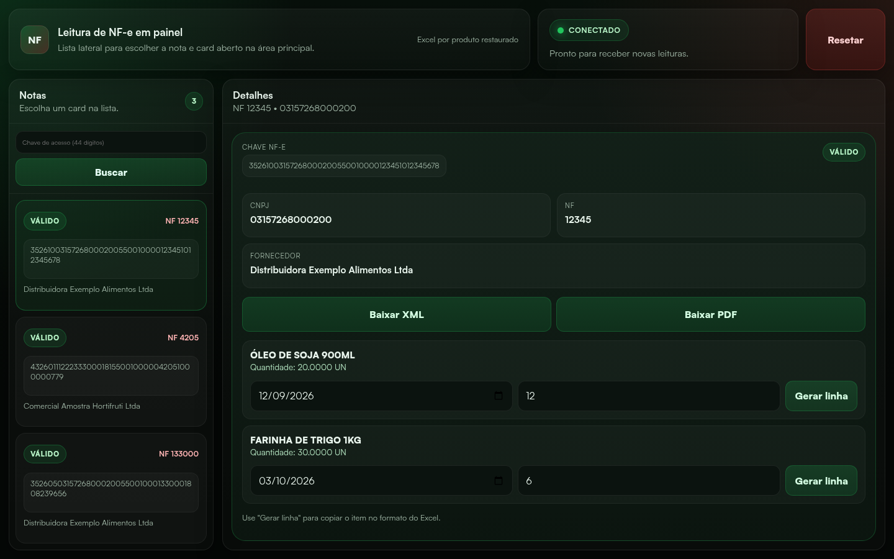
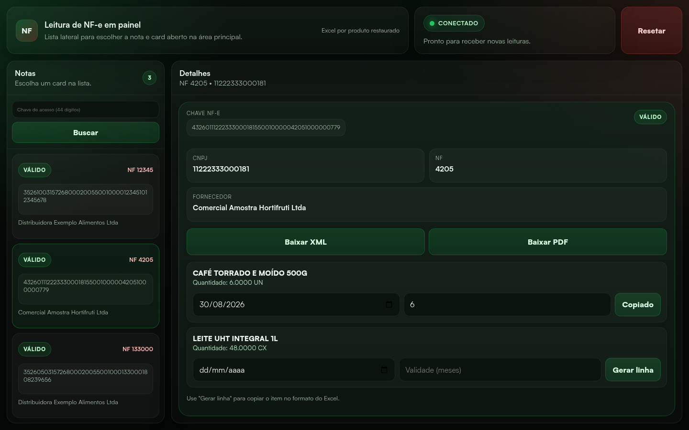
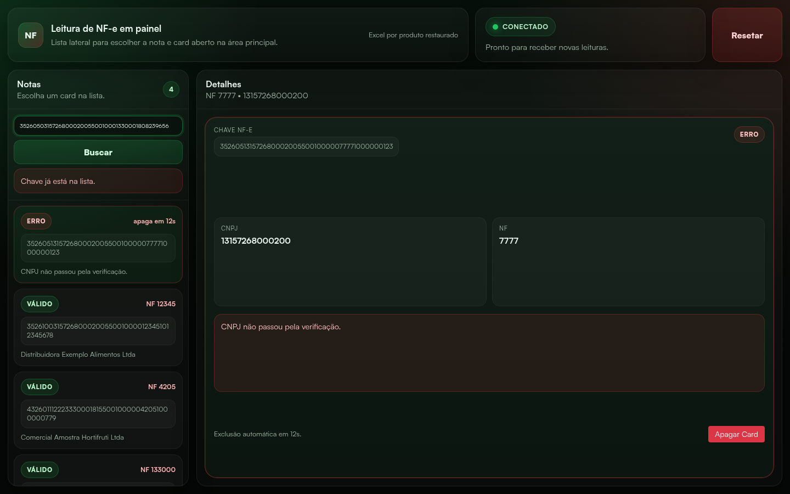

# Scanner NF-e



## Visão geral

Scanner de nota fiscal eletrônica para o **recebimento de mercadoria**. O celular
lê a chave de acesso com a câmera, o painel no desktop busca fornecedor e produtos,
e cada produto vira uma linha pronta para colar na planilha de controle. Se
precisar do documento, o XML e o PDF da nota saem do próprio painel.

## O problema

Conferir uma NF-e na mão é lento: digitar 44 dígitos, abrir a consulta do DANFE,
anotar fornecedor e produtos e ainda registrar fabricação e validade de cada item.
Aqui a chave vem da câmera, os dados chegam prontos e sobra preencher só o que a
nota não informa.

## Fluxo de uso

1. O celular abre o app e exibe um **PIN de 6 dígitos**.
2. O desktop digita o PIN no painel e os dois se conectam.
3. O operador enquadra a chave na faixa verde e toca em **Capturar chave**.
4. A nota aparece no painel com CNPJ, número, fornecedor e produtos.
5. Ele informa fabricação e validade e clica em **Gerar linha**.
6. Quando precisa arquivar a nota, usa **Baixar XML** ou **Baixar PDF**.



## O que foi construído

- **OCR no próprio celular** (Tesseract.js) sobre exatamente a área marcada na
  tela, com prévia do recorte e status colorido por estado.
- **Conexão P2P por PIN**: o PIN é o identificador da sessão do celular, que
  atende um painel por vez.
- **Painel de notas** com cartões por estado (lendo, válido, erro) e detalhe da
  nota selecionada.
- **Consulta com fallback**: XML da nota por uma API primária e, se ela falhar ou
  demorar mais de 15 s, por uma segunda. O nome do fornecedor vem da ReceitaWS.
- **Download do XML e do PDF (DANFE)** pela mesma consulta, sem chamada extra: o
  XML sai com os bytes recebidos e o botão do PDF fica desabilitado quando a
  consulta não o entrega.
- **Linha da planilha** separada por tabulação: chave, produto, data de
  recebimento, quantidade, fornecedor, fabricação, validade e número da NF.
- **Busca manual** pela chave digitada, sem celular, no mesmo fluxo das leituras,
  com aviso de formato inválido ou chave repetida.
- **Erros tratados**: CNPJ inválido ou falha na consulta geram um cartão que se
  apaga sozinho em 15 s.



## Qualidade

- 125 testes JavaScript (121 passam e 4 ficam em `skip`, documentando bugs
  conhecidos) executam as páginas reais em jsdom, simulando só PeerJS, `fetch`,
  clipboard, câmera, OCR e relógio.
- 5 testes Python cobrem o script auxiliar de consulta.
- Um teste de mutação altera o código de propósito e exige que a suíte falhe.

## Como rodar

```bash
npm install       # só jsdom (dev)
npm run build     # gera viewer.js e phone.html a partir de src/
npm test          # build + testes JavaScript
npm run test:py   # testes do api.py
```

As páginas são estáticas. A câmera exige HTTPS (ou `localhost`), e as consultas
usam caminhos relativos: o site precisa ser servido junto com o proxy do Nginx
(há um exemplo em `deploy/`). Em um servidor estático simples a conexão e a leitura
funcionam, mas as consultas de nota e fornecedor não.

## Próximos passos

- Corrigir os 4 bugs conhecidos: índice órfão ao apagar uma nota, campos que perdem
  o valor quando a tela é redesenhada, acentos quebrados na API primária e OCR
  escolhendo a janela errada de dígitos.
- Validar o dígito verificador da chave (hoje só o CNPJ embutido é conferido).

> Fornecedores, produtos e o documento dos prints são fictícios; a chave de acesso
> e o CNPJ são de exemplo.
